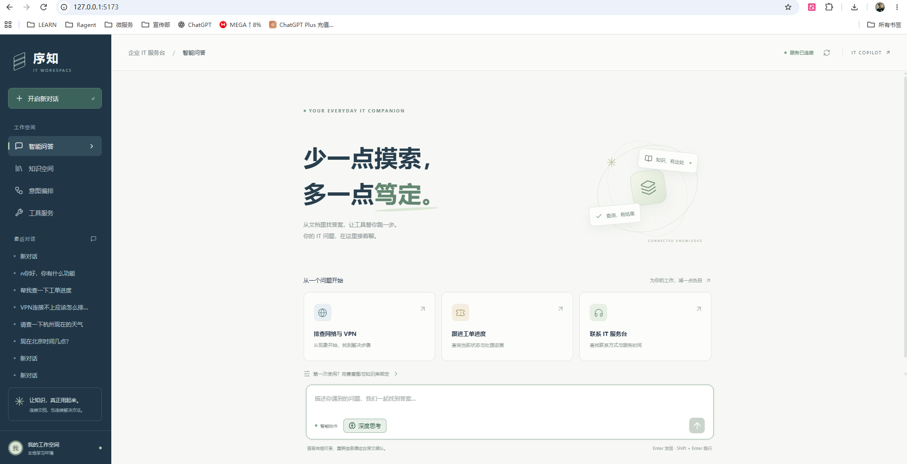

<div align="center">

#  Enterprise IT Copilot

### 基于 RAG 的企业 IT 知识库智能助手
</div>
<p align="center">
  
  
  
  
  
  
</p>
---

## 📖 项目背景

在企业日常办公中，VPN 连接、账号权限申请、开发环境配置、软件安装等问题往往需要 IT 人员反复解答。

传统企业知识库普遍存在以下问题：

- **知识分散**：内部文档分布在不同系统，查找效率低。
- **检索不准确**：传统关键词搜索难以理解用户真实意图。
- **重复咨询**：大量常见问题需要 IT 人员重复解答。
- **知识利用率低**：企业积累了大量文档，却难以快速获取有效信息。

本项目通过 **RAG + 大语言模型**，将企业内部文档构建为可语义检索的知识库，让员工通过自然语言获取有依据的 IT 问题解答。

## 项目页面展示


## ✨ 项目特点

- **原生实现 RAG**：不依赖现成 AI 框架，自主实现文档解析、Chunk 分块、Embedding、向量检索及 Prompt 组装。
- **真实企业场景**：面向企业内部 IT 知识管理，而非简单的 RAG Demo。
- **异步解耦**：基于 RocketMQ 实现文档处理任务异步化。
- **检索可优化**：支持 Chunk 去重、相似度过滤及 Rerank 扩展。
- **链路可扩展**：支持多轮对话、意图路由、MCP 工具调用及 SSE 流式输出。


## 🛠️ 技术栈

| 技术 | 作用 |
|---|---|
| Java 17 + Spring Boot | 核心业务开发与 REST API |
| PostgreSQL + pgvector | 企业知识库、Chunk 及向量存储 |
| Apache Tika | PDF、Word 等文档内容解析 |
| Redis | 多轮对话上下文管理与缓存 |
| RocketMQ | 文档解析、分块、向量化异步处理 |
| Embedding API | 文本向量化 |
| LLM API | 检索增强答案生成 |
| SseEmitter | SSE 流式回答 |

## 🔄 RAG 核心链路

### 1. 企业知识库构建

```text
企业文档上传（PDF / Word / Markdown / TXT）
                    │
                    ▼
            Apache Tika 文档解析
                    │
                    ▼
              文本清洗与分块
                    │
                    ▼
             Embedding 向量化
                    │
                    ▼
          PostgreSQL + pgvector
```

通过 RocketMQ 异步执行耗时的文档处理任务，实现文档入库与向量化。

### 2. RAG 智能问答

```text
                用户提问
                    │
                    ▼
              获取历史上下文
                    │
                    ▼
           问题重写 + 意图识别
                    │
           ┌────────┴────────┐
           ▼                 ▼
       知识库检索         工具调用（MCP）
           │                 │
           ▼                 │
      pgvector Top-K         │
           │                 │
           ▼                 │
     Chunk 去重与 Rerank     │
           │                 │
           └────────┬────────┘
                    ▼
               结果融合
                    │
                    ▼
             Prompt 上下文组装
                    │
                    ▼
                LLM 生成
                    │
                    ▼
            SSE 流式返回前端
```
---